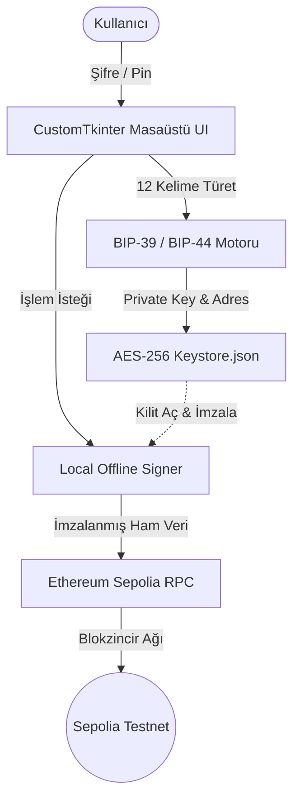

# ⚡ Non-Custodial Web3 Desktop Wallet (Sepolia Testnet)

BIP-39, BIP-44 ve Web3 standartlarına uygun, istemci tarafında (client-side) AES-256 şifrelemeyle çalışan ve çevrimdışı işlem imzalayan masaüstü kripto para cüzdanı.

---

## 🔒 Güvenlik & Mimari Prensipler

- **Non-Custodial (Emanetsiz Mimari):** Özel anahtarlar (private key) hiçbir sunucuya iletilmez; istemcinin yerel diskinde PBKDF2/Scrypt ve AES-256 (Keystore V3) ile şifreli tutulur.
- **BIP-39 Mnemonic Seed:** Kriptografik entropi ile üretilen 12 kelimelik standart kurtarma tohumu.
- **Offline Transaction Signing:** Gönderilen transferler internete açık RPC düğümüne gönderilmeden önce yerel ortamda imzalanır; ham imzasız anahtar asla ağa sızmaz.
- **Modern GUI & QR:** CustomTkinter tabanlı koyu temalı cam arayüz, tek tıkla adres kopyalama ve EIP-67 uyumlu QR kod gösterimi.

---

## 🛠️ Mimari Akış



---

## 📦 Kurulum ve Çalıştırma

### Gereksinimler
- Python 3.10+
- Pip paket yöneticisi

```bash
# Repoyu klonlayın
git clone [https://github.com/emircanbaydar/crypto-wallet.git](https://github.com/emircanbaydar/crypto-wallet.git)
cd crypto-wallet

# Bağımlılıkları yükleyin
pip install -r requirements.txt

# Masaüstü uygulamasını başlatın
python app.py
```

### Testleri Çalıştırma
```bash
pip install pytest
pytest test_wallet.py
```

---

## 📸 Arayüz Önizlemesi
*(Uygulama ekran görüntüsünü projenin ana dizinine `screenshot.png` olarak ekleyip buraya bağlayabilirsiniz)*